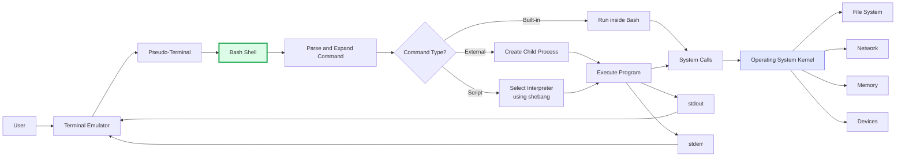

# Awesome Malicious Shell Script Detection Scientific Research 

## 📖 Contents
- [2026](#2026) | [2025](#2025) | [2024](#2024) | [2023](#2023) | [2022](#2022) | [2021](#2021) | [2020](#2020) | [Others](#old)
- [My Other Awesome Lists](#my-other-awesome-lists)
- [Contributing](#contributing)
- [Contributors](#contributors)

### 2026
-
-
-

### 2025
-
-
-

### 2024
-
-
-

### 2023
-
-
-

### 2022
-
- 
-

### 2021
-
-
-

### 2020
-
-
-

### Old
-
-
-

##

### My Other Awesome Lists
You can access the my other awesome lists [here](https://cyberthreatdefence.com/my_awesome_lists)

### Contributing
[Contributions of any kind welcome, just follow the guidelines](contributing.md)!

### Contributors
[Thanks goes to these contributors](https://github.com/cybersecurity-dev/Awesome-Malicious-Powershell-Script-Detection-Scientific-Research/graphs/contributors)!

[🔼 Back to top](#awesome-malicious-shell-script-detection-scientific-research-)
